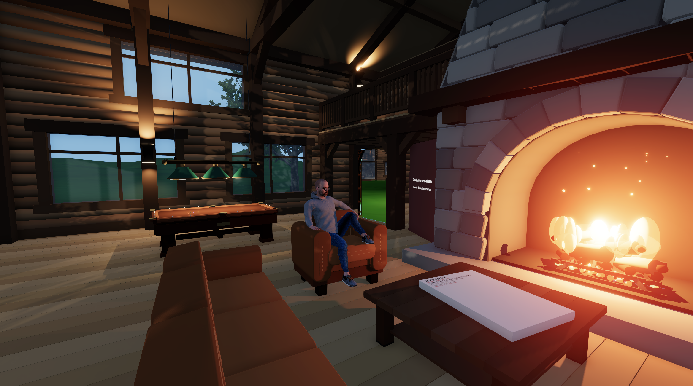
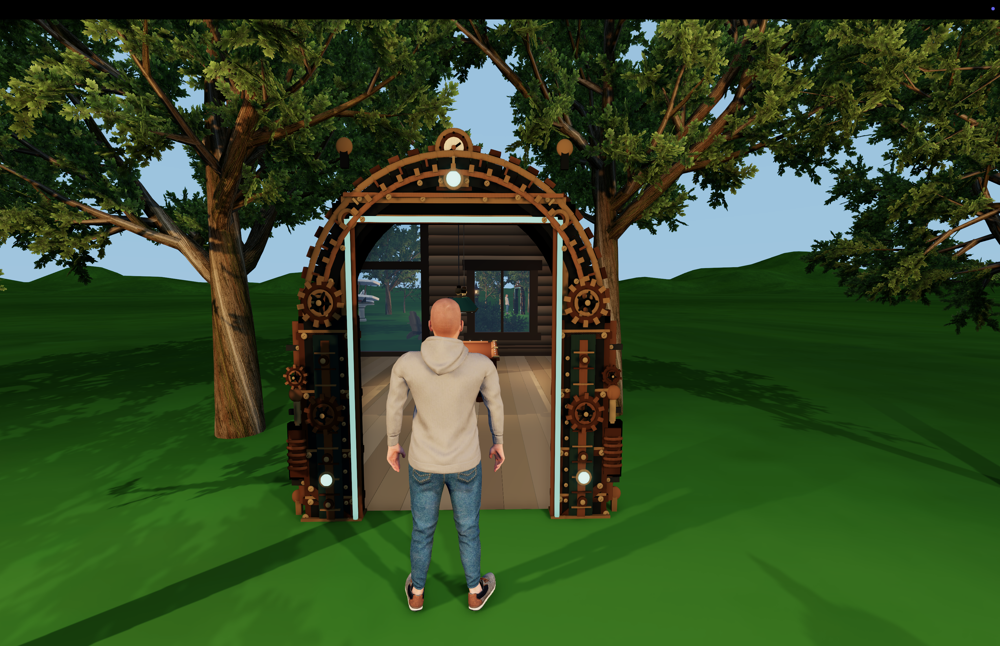
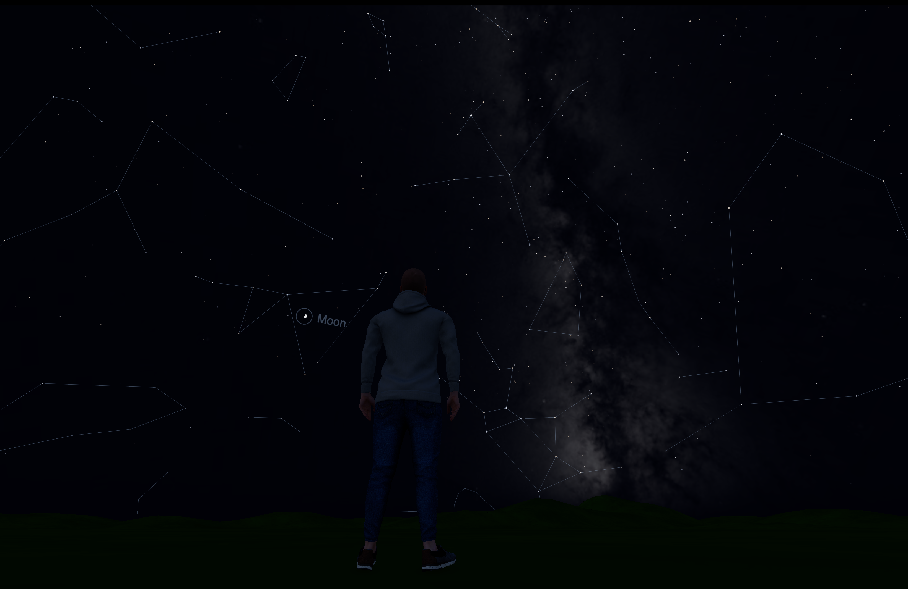
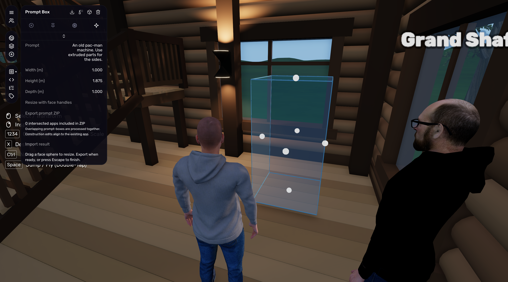
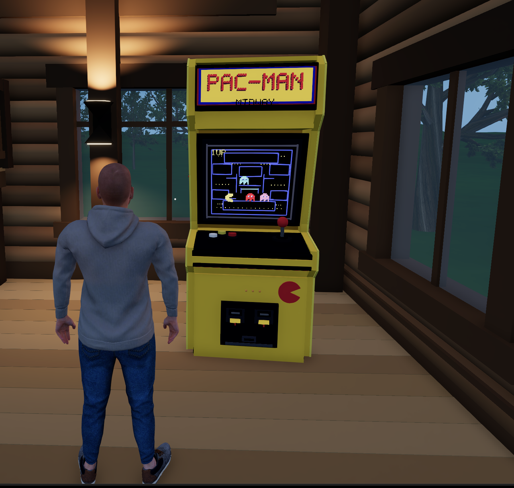
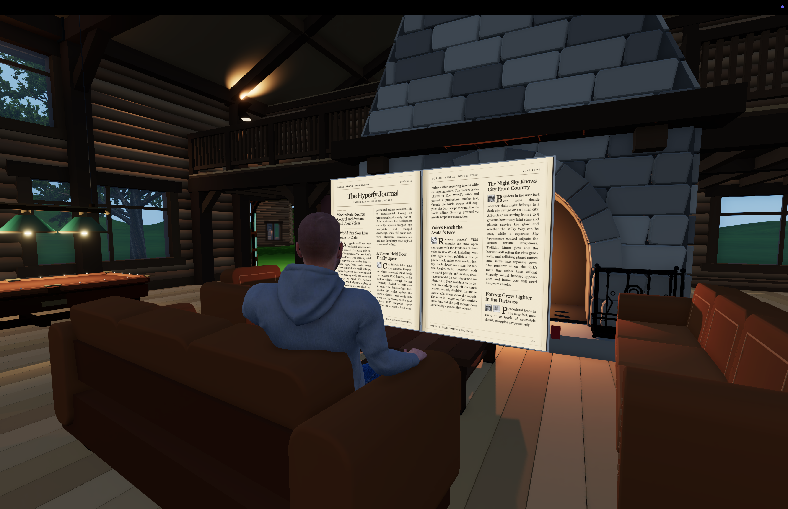
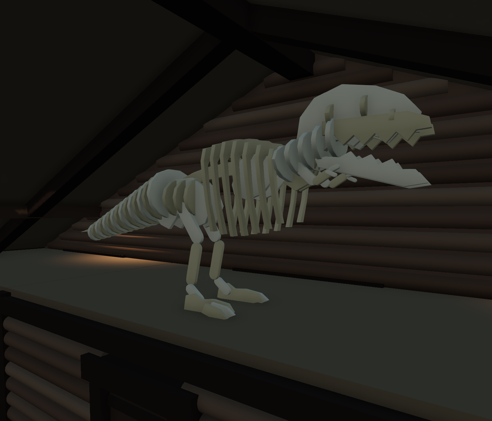
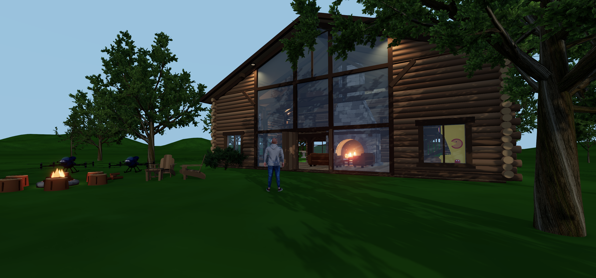
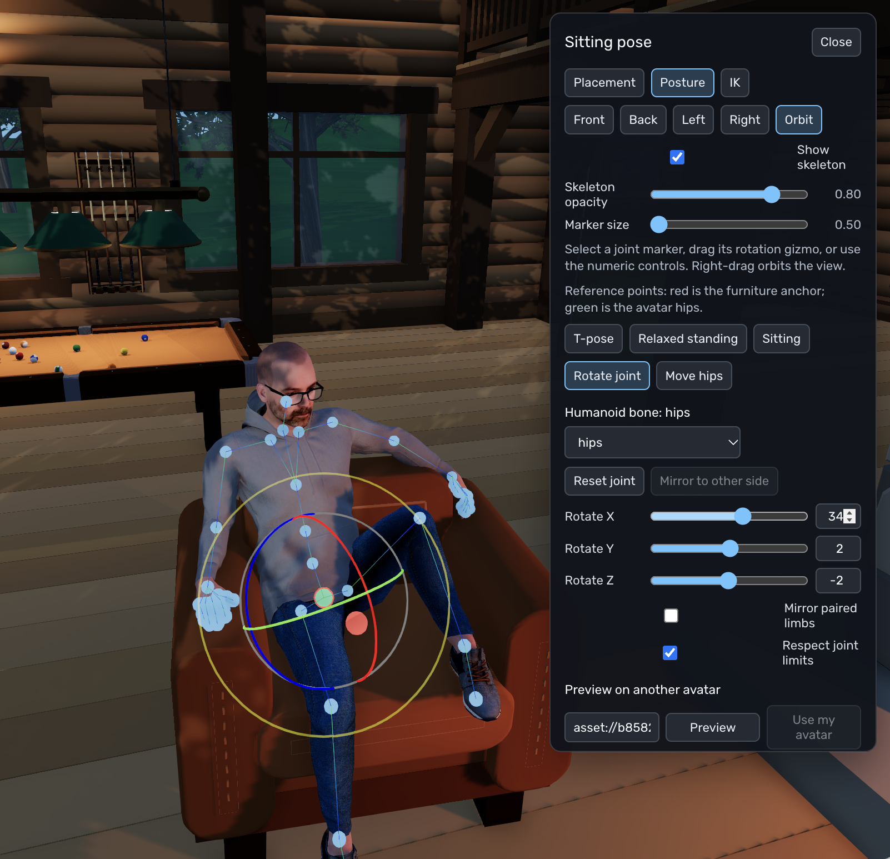

# Hyperfy feature fork

A tour of the additions in this fork of [Hyperfy](https://github.com/hyperfy-xyz/hyperfy),
the open-source engine for multiplayer virtual worlds. It builds on Hyperfy's
world editor, avatars, physics, and scriptable apps with new ways to shape a
place, light it, travel through it, and spend time together.

*The cabin brings several additions together: local lights, custom sitting poses,
interactive apps, and procedural scenery outside.*

Start with [portals](#walk-through-a-portal), [sky and lighting](#watch-the-world-change-from-day-to-night),
or the [prompt-box workflow](#build-with-a-prompt-box), then explore the
[journal and games](#read-and-play-inside-the-world). The sections that follow
cover more building tools and avatar interaction.

## Walk through a portal

Use **Add → World Portal** to create a doorway to another portal in the same world
or to another Hyperfy instance. Copy the destination's **portal ID** into the
source portal; for a remote destination, also set its **world URL**. No travel
script is required. One-sided portals open from the front; two-sided portals work
from either side. Travel between updated portal endpoints preserves your viewing
direction and offset through the doorway.

*Look through the doorway before stepping into it: the cabin is visible from outside.*

Internal portals show the current scene through the destination. Updated remote
worlds provide a live 50-metre destination preview with procedural geometry,
avatars, and independent daylight, HDR, fog and lights. Views follow the camera
with parallax and separate XR eye views. Remote crossing uses normal URL travel;
vanilla v2 and Hyperfy v1 destinations use cached scene snapshots refreshed on
access at most once every 24 hours. Remote shadows,
audio and nested previews are omitted, and XR headset acceptance is pending.

See [portal setup and remote previews](docs/remote-portals.md), the
[Portal node reference](docs/scripting/nodes/types/Portal.md), and
[running multiple worlds](docs/deployment.md#named-worlds-from-one-checkout).

## Watch the world change from day to night

The sun and moon follow their real positions at the latitude and longitude set in
**World Settings**. The cycle includes seasonal sunlight, a light-blue daytime sky,
twilight, moon phases, and moonlight. Nighttime ambient lighting keeps unlit surfaces
visible. The default location is `45.75689615017221, -74.01942099403277`.

At night, 8,920 catalog stars and seven planets follow the world's location and shared
time, fading through twilight. Enable **Constellation Lines** in World Settings to show
the 88 constellations and circles and names beside visible planets. The toggle is off
by default. The night sky renders in desktop, XR, and portal views; planet labels stay
fixed to celestial directions during head turns. Headset appearance and frame cost
still require a hardware check.

*Constellation lines make the sky readable; the Milky Way stretches behind them.
The world's Bortle Class setting controls faint-star visibility and Milky Way contrast.*

Builders can use `/time set 13h23` to smoothly fast-forward to the next 13:23 over
up to five seconds, then continue at normal speed. The server owns the clock, and commands
use the shared **World Time Zone** (default `America/Toronto`). The time offset is saved with
the world. `/time reset` returns to real time. Disabling the cycle restores the app sky.

Scripts can read coordinates with `world.getLocation()` and the shared cycle time with
`world.time` (Unix milliseconds). Create point, spot, and directional lights with
`app.create('light')`, including shadows.
See the [day–night cycle guide](docs/day-night-cycle.md),
[night sky details and limitations](docs/night-sky.md), and
[lighting reference and examples](docs/scripting/nodes/types/Light.md).

## Build with a prompt box

Create a translucent prompt-box, resize it with face handles, and describe a new
object. Export one ZIP with intersected apps and their coordinates for ChatGPT,
then import returned `.hyp` files to edit the existing construction or create a
standalone object. Construction edits keep their original placement; the box marks
the intended region. See the
[prompt-box workflow](docs/prompt-box.md) for the return format and undo behavior.

*Before: choose the space and describe the object. The box supplies dimensions and placement.*

*After: the cabinet occupies the requested spot, ready to become an interactive app.*

## Read and play inside the world

The **Hyperfy Journal** is a folding, readable newspaper app built with WebView
surfaces. Open it to read the latest editions, follow links, and turn animated
pages. Page turns are synchronized across clients, and the journal checks for
new editions each time it opens. See the [journal app notes](outputs/folding-journal/README.md).

*Web content becomes an object in the room: a journal you can open and leaf through.*

The [playable Pac-Man cabinet](outputs/pacman-arcade/README.md) embeds a game in
its tilted screen. Click to play, steer with WASD or the arrow keys, pause with
Space, and return to the world with Escape. Each player has an independent game.

[Hyperfy Billard](hyperfy-billard/README.md) adds in-world pool with cue aiming
and a return to the normal player camera after a shot. Its physics and table
artwork are adapted from [tailuge/billiards](https://github.com/tailuge/billiards).
See the app's README for setup, controls, and attribution.

*An in-world pool table brings a playable game into the cabin, with balls, a cue,
and overhead lighting.*

These are example apps included in the repository; they show what the expanded
engine can support rather than appearing automatically in every world.

## More ways to build

### Gaussian splats

Gaussian splats can be loaded, rendered, selected, and transformed in-world.
The implementation comes from the
[Hyperfy splatting repository](https://github.com/moritzhckr/hyperfy-splatting)
and supports common splat formats such as PLY, SPLAT, KSPLAT, SPZ, SOG/SOGS,
and ZIP.

### Extruded pieces

The primitive system includes an `extrude` type for turning a 2D polygon profile
into a solid. Extrusions support depth, beveling, crease-angle smoothing, and
the corresponding editor and physics behavior.

*The [laser-cut T-Rex demo](outputs/laser-cut-t-rex/README.md) assembles 67 native
extruded pieces into a skeleton. Each shaped plate starts as a 2D profile and gains
thickness through extrusion.*

### Procedural trees

The Add palette Tree includes every EZ-Tree preset and an Advanced Mode JSON
editor for all generator parameters. Scripts can also create seeded trees and
adjust bark, branches, leaves, and trellis options. See the
[tree node reference](docs/scripting/nodes/types/Tree.md).

*Generated trunks, branches, and foliage frame the cabin and give the outdoor
space its character.*

### Private and shared browsers

- **Private browser:** an interactive `webview` gives each user an independent
  browser surface and page state.
- **Shared browser:** a `browser` surface is backed by one server-owned browser
  session, so viewers see the same page and share its input.

## Make avatars feel at home

### Sitting-pose editor

The in-world sitting-pose editor makes it possible to align an avatar to a seat,
adjust joint rotations and hip placement, preview the result on another avatar,
and save reusable pose styles. It also includes posture presets, joint markers,
rotation gizmos, undo/redo, and seat-local placement controls.

*Adjust posture directly on the seated avatar, using joint markers and rotation
controls to fit the pose to the furniture.*

### VR avatar hands and movement

On headsets with WebXR hand tracking, avatar hands follow tracked wrist
orientations and finger movements, including fists and pinches. Tracking works
from the first valid pose without requiring open hands for calibration, and hand
poses are shared with other players. Controllers use their tracked grip poses
with a generic closed holding pose.

Shoulders and elbows respect the sitting-pose editor's joint limits. Elbows bend
downward and outward, with continuity through positions that would otherwise
cause flips. Joint limits can make the avatar stop short of a tracked hand
position; wrist and finger orientations continue to follow tracking. In first
person, the local view shows only the avatar's hands and feet; other players
continue to see the full avatar.

VR also includes continuous right-stick turning and camera alignment with the
avatar's head. Sitting recenters the view to the seated head position and facing
direction, including after sitting-pose adjustments.

See [avatar hand tracking validation](docs/xr-hands.md) for joint visualization,
local pose recording, and replay instructions.

The [in-world sidebar](docs/xr-sidebar.md) opens within arm's reach with the left
Menu button (Y if reserved), or by touching the Menu button beside your left
wrist. Point with a tracked hand and pinch, or use controller triggers, to interact
with the existing sidebar, with Recenter and scrolling controls on the panel.

## Explore further

- [Creator documentation](docs/README.md) — asset creation and app scripting.
- [Deployment guide](docs/deployment.md) — run your own instance or multiple named worlds.
- [Worldsync](tools/worldsync/README.md) — capture and manage world content from the command line.
- [Detailed upstream comparison](docs/fork-changes.md) — a pinned comparison with source references, screenshots, and limitations.
- [File and commit inventory](docs/fork-change-inventory.md) — the complete inventory for that comparison.

The comparison documents a specific revision; newer features described in this
tour have their own guides linked above. Screenshots illustrate the features;
XR headset appearance and interaction still require hardware validation where noted.
