# Changes from official Hyperfy main

This guide describes the complete **net change** from official
[Hyperfy main](https://github.com/hyperfy-xyz/hyperfy/tree/5d20037435a1d86cda088382bb12737e9f18d5f6)
to this checkout. It includes inherited splatting/development work as well as this
fork's additions. A reverted experiment is history, rather than a current feature.

| Comparison | Pinned revision |
| --- | --- |
| Official `hyperfy-xyz/hyperfy` main, fetched October 10, 2026 | `5d20037435a1d86cda088382bb12737e9f18d5f6` |
| Documented branch, `codex/lighting-optimization` | `192087f8bc776b3733573dad5156fb3e6d57d7d5` |
| Fork `origin/main`, for reference only | `7cea690` |
| Scope before this documentation | 254 changed files; 40,396 inserted and 5,511 deleted lines; 125 commits ahead, none behind |

Official main is an ancestor of the documented revision. The comparison is a
two-revision tree diff, not a comparison against the fork's main. The fork-main
comparison alone would include only the latest lighting optimization.

The [complete inventory](fork-change-inventory.md) lists **every changed path**,
dependency declaration change, and intervening commit, including merges and
reverts. Use that appendix for exact coverage; the sections below explain the
resulting behavior. These documents and their new screenshots are excluded from
the pinned 254-file comparison.

## Screenshot method and evidence

All screenshots were captured in Chrome from
[Évain](https://monstre.duckdns.org:3333/) on October 10, 2026, Toronto time.
The requested `jerome-grounded.vrm` was already selected. Its local file hash and
the live avatar URL matched:
`b8582954928c59eea084f57eee6fd38b5a851aabc5b3c2d42b82dd8fe18ffc42`.

Daylight captures use a **temporary client-only environmental preview** at
13:23 Toronto time on that date. The shared clock was left at offset zero with no
transition. The night view uses the real shared clock. Camera framing was adjusted
locally. The prompt box, extrusion, WebView, and seat preview were temporary local
demonstrations; no prompt result or pose was applied or saved. The seat preview
used an existing Adirondack chair. All temporary examples and overrides were
removed, and the page was reloaded afterward.

Captures show the actual engine and controls, without fabricated UI. They are
illustrations, not proof of multiplayer behavior, headset tracking, export/import
roundtrips, or performance. The FPS overlay is incidental and is **not a benchmark**.
Two limitations observed during capture are recorded explicitly below.

## 1. Gaussian splats and their loading pipeline

Vanilla main has model/avatar loading and mesh primitives. This branch adds a
`gaussiansplat` node and a Gaussian Splat app, integrating Spark with the existing
scene, loader, app list, file fields, and builder.

- Drop a splat file into the world or choose **Add App → Gaussian Splat**. File
  controls accept PLY, SPLAT, KSPLAT, SPZ, SOG, SOGS, and ZIP. The shared detector
  additionally recognizes `sogszip` and `.spz.gz`; file-picker filters are narrower.
- The inspector exposes source file, sort mode, tint, opacity, and LOD splat scale.
  Sort mode is retained for compatibility but has no rendering effect: Spark
  sorts automatically. The node also stores shadow flags without implementing
  a splat-specific shadow-casting pass in the Stage setup.
- Spark handles decoding and progressive loading. Loading indicators show
  progress, elapsed wait, and failure state. Dynamic imports keep browser-only
  Spark code out of server execution; a cached module avoids repeated imports.
- Device tiers supply LOD budgets and Gaussian extent defaults for desktop,
  mobile, Quest, and Vision Pro. LOD splat scale is renderer-wide in this version,
  even though the app exposes its control.
- Selection raycasts real splats and compares their distance with mesh hits.
  Builder transforms preserve rotation, use an internal 180° X correction,
  and avoid rebuilding an app solely when starting/finishing a move. Splats use
  transform mode rather than expensive grab behavior where applicable.
- A duplicated splat gets its own blueprint and app-list entry. Load/handle
  generation counters invalidate obsolete asynchronous loads, preventing deleted
  or replaced splats from reappearing. Teardown disposes meshes and releases
  cached bytes where appropriate.
- The server serves binary formats with range support and immutable asset
  caching, without HTTP gzip decoding SPZ before Spark can decode it.

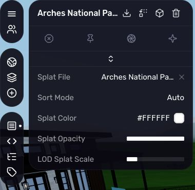

*The live ZIP-backed app exposes source, tint, opacity, and LOD controls. This is
a deliberate crop of the inspector. During this capture, all three live Spark
meshes reported `isInitialized: false` and zero splats, despite node-level
`loadingState: loaded`. Successful visible splat rendering is therefore **not
verified by this screenshot**; the cause was not investigated in this task.*

Implementation: [GaussianSplat](../src/core/nodes/GaussianSplat.js),
[Stage](../src/core/systems/Stage.js), [ClientLoader](../src/core/systems/ClientLoader.js),
[format detection](../src/core/utils/splatFormats.js), and
[app template](../apps/GaussianSplat.js). The older
[implementation notes](gaussian-splatting-implementation.md) and
[TODO](gaussian-splatting-todo.md) describe historical stages; use current source
for the retained behavior.

## 2. Rendering, lights, and live-shadow performance

The branch adds `app.create('light')` with point, spot, and directional types,
color/intensity, point/spot distance and decay, spotlight angle/penumbra, and
optional shadows. Spot and directional lights aim along local −Y, following
parent transforms. Lights create render objects on clients. A glowing emissive
bulb still needs a Light node to illuminate neighboring surfaces.

Rendering accommodates splats and CSS3D surfaces alongside existing meshes:

- The alpha WebGL canvas permits depth-occluded CSS3D WebViews behind it;
  pointer events reach the appropriate surface.
- World UI renders after splats. Bloom, AO, SMAA, and tone mapping remain in the
  forward composer; the branch stays on postprocessing 6.x for Spark compatibility.
- Direct rendering, including XR and postprocessing-off mode, applies ACES tone
  mapping on the renderer. Composer rendering applies its own tone-mapping effect.
- Shadow fixes use current Three.js shadow behavior and CSM changes rather than
  assuming the old dependency APIs still apply. HDR loading uses `HDRLoader`.
- The latest optimization enables standard Three.js frustum culling on linked
  instance batches. Moving instances and dirty batch cleanup invalidate their
  bounding spheres, including resizing and removal. Static bounds can be reused.
  Shadow maps still refresh normally; frozen and throttled maps were experiments
  that were rejected as defaults.

The committed [experiment report](lighting-optimization.md) records a matched,
connected night-scene control at 11.081 FPS and a final culling sample at 29.021
FPS, with mean frame intervals 90.245 → 34.458 ms and p95 109.700 → 39.100 ms.
These are **previous measurements in that scene**, not newly measured results or
a guarantee for other worlds. Moving-caster bounds and refresh probes are
described separately from perceptual quality checks in that report.

See the [Light reference](scripting/nodes/types/Light.md),
[Light implementation](../src/core/nodes/Light.js),
[ClientGraphics](../src/core/systems/ClientGraphics.js),
[CSM](../src/core/libs/csm/CSM.js), and [Stage regressions](../src/core/systems/Stage.test.mjs).

## 3. Location-based day–night cycle and synchronized world time

Vanilla main uses the sky app's background and fixed sunlight settings. The
branch adds a procedural sky driven by date, latitude, and longitude, visible
sun/moon positions, lunar illumination and tilt, seasonal sunlight, and twilight.
HDR ambient intensity fades to 20% at night; app lamps retain their own brightness.
Moonlight adds illumination without another shadow map.

**World Settings** adds Day–Night Cycle, Latitude, Longitude, and a grouped IANA
World Time Zone selector. Defaults are an enabled cycle, coordinates
`45.75689615017221, -74.01942099403277`, and `America/Toronto`. Disabling the cycle
restores the sky app's background, sunlight direction, and full HDR intensity.

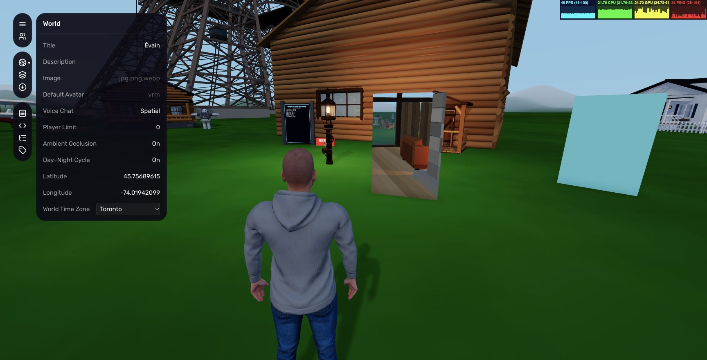

*The controls and saved geographic settings are visible against the local
daylight preview. The geographic location is a world setting, not device GPS.*

The server owns time. Clients synchronize when joining, periodically, and when
returning to a tab, then advance a monotonic estimate with network-delay
correction. `/time set 13h23` requires builder permission and advances to the next
matching time in the world's timezone over up to five seconds. The saved offset
then advances normally. Commands and confirmations are shared, including with
late arrivals. `/time reset` returns to real time. DST skipped/repeated times are
handled in the timezone conversion rather than each player's device timezone.

Scripts gain read-only `world.time` in Unix milliseconds, `world.timeZone`, and
`world.getLocation()`. Existing `world.getTime()` remains the network clock in
seconds; `world.getTimestamp()` remains the executing machine's real clock.

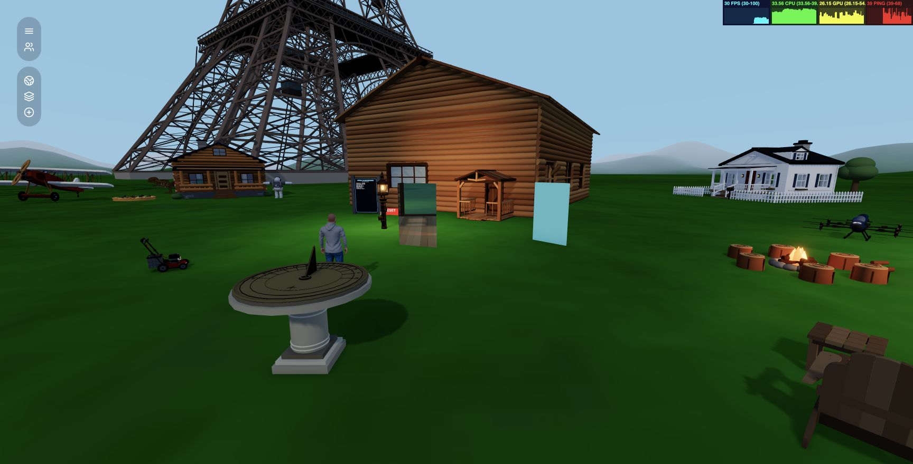

*Local daylight preview: blue sky, directional sunlight, and shadows. The avatar
in this view is `jerome-grounded.vrm`.*

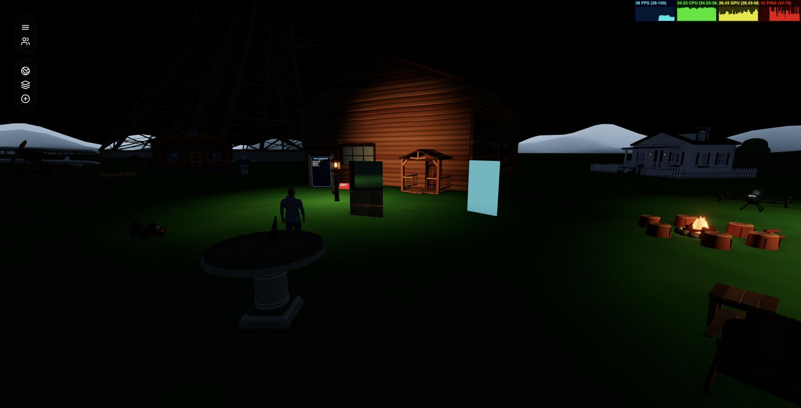

*Same camera at the shared nighttime clock: lamps illuminate the cabin and ground,
while ambient light dims. Scene animation can vary between captures.*

Details: [day–night guide](day-night-cycle.md), [dayNight](../src/core/extras/dayNight.js),
[ClientEnvironment](../src/core/systems/ClientEnvironment.js),
[Settings](../src/core/systems/Settings.js), and
[time synchronization](../src/core/systems/ClientNetwork.js).

## 4. Native portal views and traversal

The new World Portal app supports destination world URLs or another portal ID.
With the world URL blank, copying one endpoint's ID into the other endpoint's
destination field links them within the same world.

The native `portal` node renders the existing scene through a transformed camera,
with parallax, clipping at the destination doorway, and separate per-eye views in
XR. Travel uses the same half-turn between portal frames, preserving viewing
angle and lateral offset. Front entry exits the destination's front; back entry
exits its back. Arrival clearance avoids an immediate return, and the third-person
camera boom stops at the aperture.

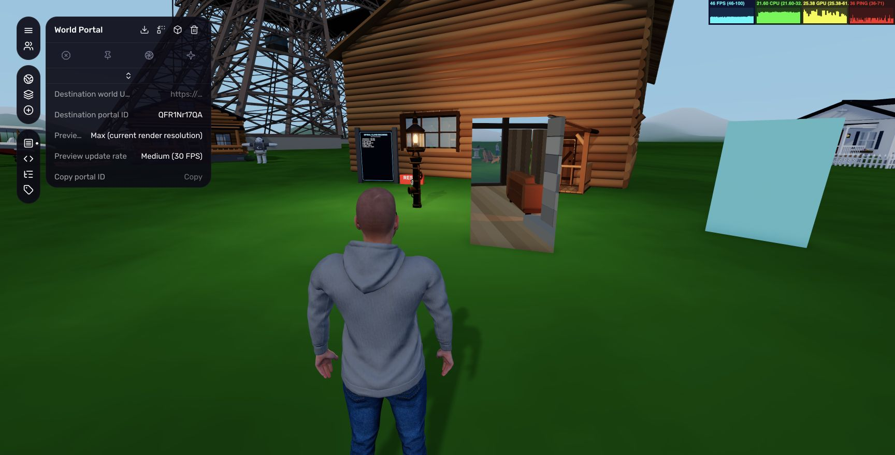

*The aperture shows a different part of the cabin scene. The inspector has a
destination ID, Max resolution, and 30 FPS selected. The teal surface beside it
illustrates an endpoint without a usable same-world preview. Daylight is local.*

Preview resolution defaults to 256 pixels and update rate to 15 FPS. Alternatives
are 512, 1024, or Max at the renderer's current pixel dimensions, and 30 FPS or
every frame. XR Max follows each eye's viewport. Cached views update immediately
after relevant target/side/size/rate changes. Each visible portal adds scene passes;
low defaults limit their cost.

Nested portals are omitted to prevent recursion; destination passes reuse lighting
and existing shadows without rerunning the main AO/bloom composer. Spark buffers
are separate per portal view. CSS3D WebViews cannot appear in the WebGL preview.
Remote-world **travel** is supported by URL, but remote-world **previews** are not.
Headset rendering and representative streamed-splat LOD need their own checks.

The earlier iframe-based portal preview was reverted and superseded by native 3D
rendering. Existing placed apps must be replaced with the new WorldPortal package
to receive its script behavior; engine updates alone do not rewrite old apps.
Replacement keeps the instance ID and placement but uses the package's properties,
so record and reapply destination settings.

References: [Portal](scripting/nodes/types/Portal.md),
[portal camera math](../src/core/extras/portalCamera.js),
[native node](../src/core/nodes/Portal.js), and
[World Portal app](../outputs/world-portal/world_portal.js).

## 5. Extruded primitives and invisible interaction geometry

The existing `prim` API gains `type: 'extrude'`. A 2D XY polygon `profile` is
extruded along Z using `depth`. Bevel size/thickness/segments, curve segments,
smooth normals, and crease angle control the resulting geometry. The geometry
cache includes extrusion options, and copying a primitive copies its profile.
These properties are also available through node editing and script proxies.

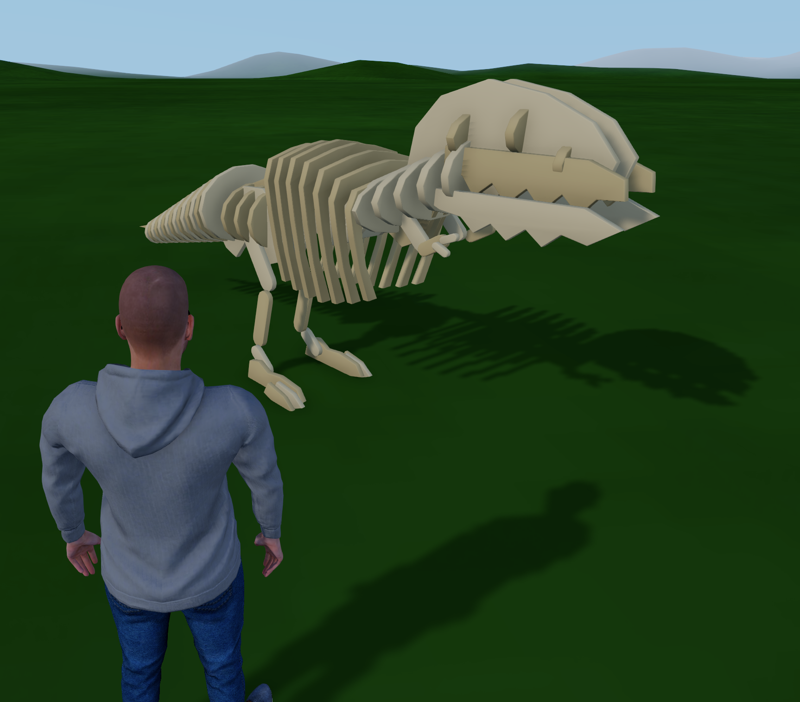

*The repository's `outputs/laser-cut-t-rex`

Physics uses the primitive system's convex mesh path. A concave visible profile
therefore collides as its **convex hull**; it does not create a matching concave
hole automatically. For accurate openings, build collision from separate pieces.

Opacity-zero primitives now retain spatial-octree entries for pointer interaction,
including movement and teardown, while skipping their visible mesh. This supports
invisible hit targets without equating invisibility with disabled interaction.

See [Prim](scripting/nodes/types/Prim.md), [implementation](../src/core/nodes/Prim.js),
[extrusion authoring](../hyperfy-skill/docs/extrusion.md), and
[example source](../examples/irregular-extrude.js).

## 6. Private WebViews and shared browsers

Both are new relative to the pinned official main, but they have different state
ownership and rendering capabilities:

| | Private `webview` | Shared `browser` |
| --- | --- | --- |
| Page state | Independent iframe per client | Server-owned Chrome context per app instance |
| Surface | CSS3D world surface or 2D screen overlay | WebGL screenshot texture |
| Interaction | Browser-native iframe input | Forwarded clicks, movement, scrolling, keyboard input |
| Shared viewing | Each visitor can see a different page | Visitors to the same app share page and input order |
| Key limitations | Embedding policies, cookies, browser permissions, CSS3D not in portal WebGL passes | Requires server Chrome/CDP; refresh interval and network latency; shared input contention |

WebViews inherit world transforms, sizing, factor/resolution, double-sided and
interactive properties; child sizing and frame wobble fixes are included.
World-space interaction unlocks the pointer outside build mode. The optional
server proxy accepts public HTTP(S) pages, strips frame-blocking response headers,
and rewrites common HTML/CSS resources. It rejects localhost/private-network
targets and does not forward an existing user's login cookies. Some applications
will still fail because their browser/API assumptions exceed proxy rewriting.

Shared browsers use isolated server browser contexts between app instances;
viewers of the same instance share state. Bare hostnames become HTTPS URLs. Click
to focus keyboard input and press Escape to return to the world. The server
validates that screenshot/input requests refer to a matching browser app, filters
inputs, and closes sessions on app removal/server shutdown. `BROWSER_CDP_URL`
selects an external endpoint; otherwise a managed temporary-profile Chrome is
started. `BROWSER_HEADLESS=false` exposes that server browser window.

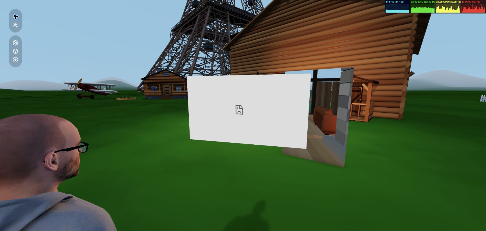

*A temporary local WebView exists in the 3D scene, but Chrome blocked the attempted
same-world `/health` page. The earlier `example.com` attempt failed DNS resolution.
This screenshot documents a capture limitation, not successful page browsing.
No security interstitial was bypassed. Shared browser interaction and WebView proxy
behavior were not exercised end to end in this capture session.*

References: [WebView](scripting/nodes/types/WebView.md),
[Browser](scripting/nodes/types/Browser.md), [BrowserCapture](../src/server/BrowserCapture.js),
[proxy](../src/server/WebViewProxy.js), and [examples](../examples/private-browser.js).
The WebView reference's old phrase “shared read-only browser” is superseded by the
interactive shared Browser implementation and its current reference.

## 7. Sitting-pose editor, reusable calibration, and GLB export

Vanilla main can attach players to anchors. This branch adds per-avatar pose and
seat-placement customization. While seated on desktop, **Customize sitting** opens
the editor; furniture scripts can also call `player.editSittingPose({ guides })`.

Placement adjusts seat-local offsets and yaw. Posture edits normalized humanoid
bone rotations and hips translation, using skeleton markers, rotation gizmos,
numeric fields, joint limits, optional paired-limb mirroring, and presets. IK moves
hands/feet/back with alignment guides. Front/back/side/orbit cameras, skeleton
opacity, marker size, and undo/redo make placement inspectable. Camera focus,
avatar scene cloning, skinned preview transforms, and zoom reset fixes are included.

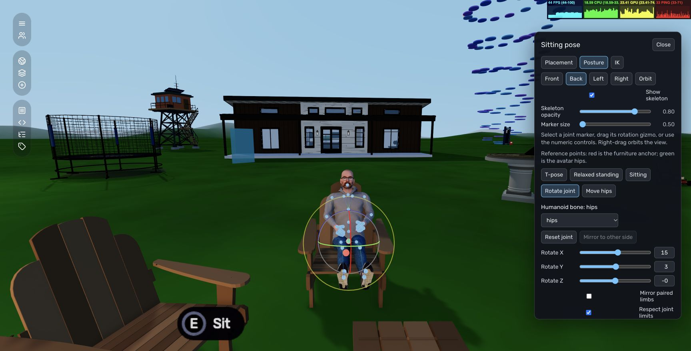

*Actual editor, `jerome-grounded.vrm`, and an existing chair. The Sitting preset and
joint markers are shown in a temporary local seat preview, with a locally framed
camera and daylight. This preview was cancelled; it is not a saved calibration.*

**Apply to this seat** saves for the current user, avatar, and anchor. An anchor's
optional `profileId` enables an explicit save for compatible furniture/seat roles;
ordinary Apply remains instance-specific. Reusable named styles store posture,
with a maximum of 20 per user. Reset restores the default sitting behavior.

The server checks player ownership, current seat, profile, avatar, and bounded pose
data, then persists and broadcasts the resulting calibration. Clients cannot set
authoritative `seatPose` through a generic player modification. Pose overrides
apply to local and remote avatars, while the initial editor preview remains local.

**Download** exports the previewed avatar as `sitting-pose.glb`, with a one-second
constant `SittingPose` animation. It includes posture and avatar-local hips
translation, excluding seat placement/guides. Alternate preview avatars can be
exported without applying. This is ordinary glTF, with approximated standard
materials and no VRM metadata; another skeleton needs retargeting.

References: [Player API](scripting/world/Player.md), [Anchor profiles](scripting/nodes/types/Anchor.md),
[editor](../src/core/systems/ClientPoseEditor.js), [pose validation](../src/core/extras/seatPose.js),
[GLB export](../src/core/extras/exportPose.js), and
[sitting authoring guide](../hyperfy-skill/docs/sitting.md).

## 8. Avatar selection, first person, movement, and VR hands

The inspector for a placed VRM now offers **Wear avatar**. Preferences additionally
list avatars held by users on the server, deduplicated and restricted to available
local VRM assets by `/api/avatars`.

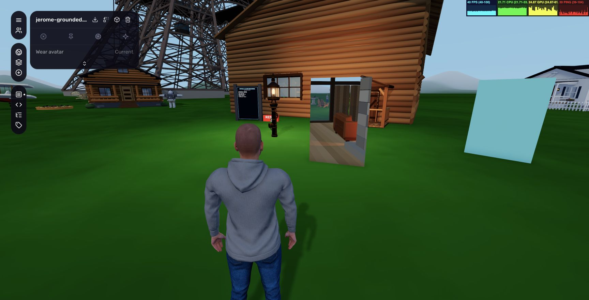

*The placed `jerome-grounded.vrm` inspector says Wear avatar → Current. The same
skin was used for all deliberately staged avatar views.*

Player movement now uses the existing PhysX character-controller node for local
movement, replacing the former local capsule movement path. Walking, collision,
ground/ceiling flags, stepping, platform motion, pushes, flight, and XR displacement
are integrated around controller foot position and frame delta. Controllers tag
their owning player and handle grounding queries before movement safely. This is
an internal movement change; screenshots alone cannot validate collision behavior.
Skinned GLBs also gain selectable geometry and dynamic bounds support.

First-person local rendering shows only hands and feet rather than the whole body;
other players retain the full avatar. Avatar camera focus, head alignment, seated
camera collision/recentering, and seated pose adjustments receive corresponding fixes.

VR adds continuous right-stick turning and shared hand/controller poses. Tracked
wrist/joint orientations are retargeted through VRM rest-pose corrections and the
current parent transforms, including thumb orientation and terminal finger segments.
Tracking may start with a fist; there is no open-hand calibration requirement.
Shoulder/elbow IK respects joint limits and maintains bend-side continuity.
Controller grips use a generic closed holding pose; exact per-controller fit is
not established. Stale tracking is cleared when pose/session validity is lost.

The `h` network packet distinguishes hand/controller kind and carries wrist/finger
pose data. Server sanitization and remote avatars use the same mapping. Update
server and clients together when switching from the earlier packet format.
Action prompts use E on desktop, X with a left VR controller, and no keyboard
letter for tracked hands; XR action distance uses the actual world camera.

`?xrHands=1&xrRecord=1` enables joint visualization and a local ten-second capture,
at up to 30 samples/second, downloaded on leaving VR. `npm run xr:hands:replay --
/path/to/xr-hands.json [avatar.vrm]` checks mapping through the actual avatar factory
and packet sanitizer. The existing guide records an October 1 headset confirmation;
**no new headset session was performed for this document**.

References: [XR hands](xr-hands.md), [PlayerLocal](../src/core/entities/PlayerLocal.js),
[VRM factory](../src/core/extras/createVRMFactory.js),
[retargeting](../src/core/extras/handRetargeting.js), and
[hand packet validation](../src/core/extras/handTracking.js).

## 9. In-world VR sidebar and pointer routing

The desktop React sidebar is reused inside VR as an HTMLMesh surface, preserving
the normal permissions and controls. Open it with the left controller Menu button,
Y when Menu is reserved, or the Menu control beside the left wrist with tracked
hands. Point/pinch or controller rays/triggers select controls; hold to drag sliders.
The panel has Recenter, Close, and scrolling controls.

It appears about 70 cm in front of movement direction and 22 cm below eye level.
Walking, physical movement, turning, and teleporting carry it with the avatar;
head look/tilt does not rotate it. Selection cancellation/tracking loss and trigger
capture prevent sidebar gestures from also activating world objects. SVG hit
targets, sliders, CoreUI event routing, and confirmations are adapted for XR.
Leaving VR restores the desktop sidebar. Text entry, file pickers, and browser
dialogs remain dependent on the headset browser; no custom VR keyboard is added.

This desktop capture session cannot supply a meaningful real-headset screenshot.
The [XR sidebar guide](xr-sidebar.md) separates synthetic browser checks from the
remaining headset checks. Implementation: [ClientXRUI](../src/core/systems/ClientXRUI.js),
[XRDOMSurface](../src/core/extras/XRDOMSurface.js),
[XRSidebar](../src/client/components/XRSidebar.js), and
[pointer routing](../src/core/systems/ClientPointer.js).

## 10. Prompt-box generation and construction edits

Vanilla main has app imports and an AI generation system. This branch adds a
separate portable authoring workflow: **Add App → Prompt Box**, describe the
request, define its volume, export context, submit the ZIP to an authoring tool,
and import the returned app(s). The exporter does not automatically submit to
ChatGPT, and the importer does not infer architecture or cut walls itself.

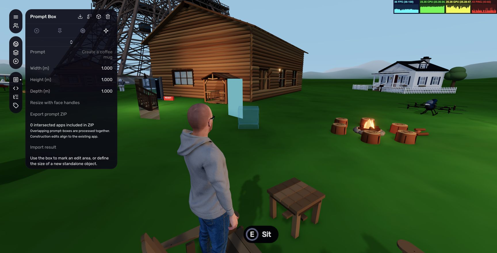

*A temporary local 1 m box shows prompt, dimensions, face-resize, export, intersected
app count, and import controls. The scene volume is visible ahead of Jerome's
avatar. No generation request was exported or applied during capture.*

Height changes keep the bottom fixed; width/depth resize around the center.
Dragging one of six face handles holds the opposite face fixed. Scale mode uses
these handles; Escape finishes resizing. Minimum dimension is 0.01 m. Desktop
pointer resizing is supported; VR can use dimension fields.

The ZIP includes the request, coordinate/replacement manifest, authoring guidance,
the complete `hyperfy-skill`, a working placeholder, and separate `.hyp` files for
intersected app instances. Selection uses oriented box/geometry bounds including
child transforms and instance scale, with support for meshes, primitives, UI,
skinned geometry, and splats. It excludes players, invisible geometry, disabled
apps, and scene apps. Bounds are conservative for hollow/curved parts.

Overlapping boxes are processed together and each requires a prompt. Manifest
transforms state how each original app maps into the box frame. A construction
edit is authored in the original app's local frame and targets that instance;
a standalone object replaces its box at its transform with unit scale. Multiple
edits of one construction are combined into one result. Explicit request/target
tags prevent a changed house from being imported at the box origin.

Import validates package boundaries/assets, request identity, current box and
target snapshots, and target eligibility. It loads and builds replacements before
publishing changes, rolling back detected build failures. Each target receives a
fresh blueprint, preserving other linked instances. Construction edits preserve
instance ID, position, rotation, scale, and state. Completed boxes are consumed;
one undo restores the whole result. Request data survives reload, while undo
history lasts only for the browser session.

Result imports remain limited to 50 MB including expanded ZIP content, even when
general uploads are unlimited. Old version-1 standalone results remain supported;
version-2 results require explicit target tags. Ordinary `.hyp` drops create apps;
ordinary ZIP drops still use the splat workflow. Use **Import result** for this
workflow. The bundled validation tools check scripts, rebuilt `.hyp` assets/hashes,
and final result archives before delivery.

Details: [prompt-box guide](prompt-box.md),
[workflow](../src/core/extras/PromptBoxWorkflow.js),
[intersections](../src/core/extras/promptBoxIntersections.js),
[resize controls](../src/core/extras/PromptBoxResizeControls.js), and
[result validation](../hyperfy-skill/tools/validate_result.py).

## 11. General app replacement and builder usability

**Replace from .hyp** is added to app inspectors and the app menu. It replaces
one placed instance without changing ID or placement, gives it a fresh blueprint,
and resets instance state to the new package's starting state. Other instances
of the old blueprint remain unchanged. A failed build restores the original;
undo restores its previous blueprint and state. This differs from prompt-box
construction edits, which preserve construction state.

App packaging now skips dummy `script-only` models and validates header length,
asset sizes, and package boundaries on import. Script-only apps start from an
empty group. `App.modify()`/`crash()` return build promises so replacement can
wait for actual completion. Node script-proxy storage is renamed to `_nodeProxy`
to avoid colliding with WebView's public `proxy` property.

The Add pane combines the default collection with usable installed world
blueprints, filtering scene/disabled/prompt-box entries and deduplicating built-ins.
Default collection additions include Gaussian Splat, two Primitive Cottages,
and World Portal. Builder keyboard handling adds Delete/Backspace deletion,
improved splat selection, and local/world transform switching for supported modes.
Fields gain X/Y/Z labels, tooltips, splat file kinds, native grouped selects, copy
actions, and extrusion editing. Script-editor layout is resizable in the sidebar;
code keeps its normal horizontal scrolling rather than a new forced-wrap behavior.

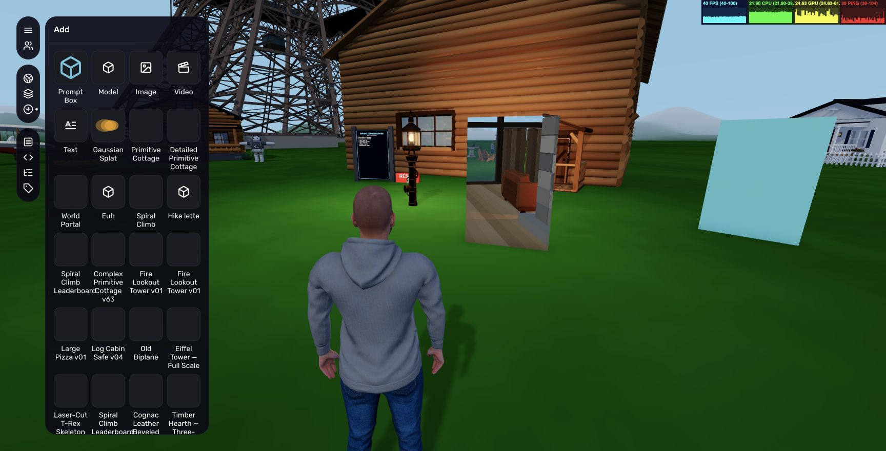

*Prompt Box, Gaussian Splat, cottages, World Portal, and installed world apps are
available from one Add pane.*

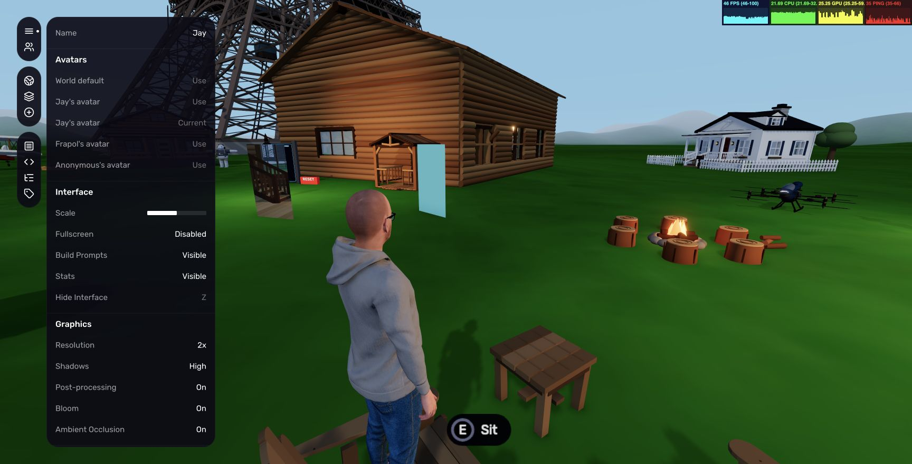

*Server avatar choices coexist with the normal resolution, shadows, bloom, AO,
and postprocessing controls.*

Script URL-parameter updates now retain the page hash and omit a trailing empty
question mark. References: [app tools](../src/core/extras/appTools.js),
[addable blueprints](../src/client/components/addableBlueprints.js),
[Sidebar](../src/client/components/Sidebar.js), [Fields](../src/client/components/Fields.js),
and [Apps API](../src/core/systems/Apps.js).

## 12. Server operations, configuration, and AI compatibility

The server changes include:

- Optional direct TLS via paired `TLS_KEY_FILE`/`TLS_CERT_FILE` paths; supplying
  only one is rejected. CORS can be configured through `CORS_ORIGIN`.
- `PUBLIC_MAX_UPLOAD_SIZE=0` means unlimited general uploads; positive values
  limit multipart upload size in MB. Startup rejects negative/nonfinite limits,
  and truncated uploads are rejected. Uploads still collect file bytes in memory;
  unlimited is not a streaming-memory guarantee.
- Binary asset MIME/range/caching handling and selective HTTP compression support
  the splat pipeline. Updated Fastify header APIs preserve serving behavior.
- `/api/backup` returns a completed ZIP of the world, and `/api/restore` replaces
  the world directory and requires restart. Both require a configured matching
  admin code. These routes were inspected, not invoked.
- `/health` returns health/timestamp/uptime. `/status` reports running-world
  status, users, and commit hash. `Storage.delete()` supports persisted pose reset.
- Browser capture/proxy/avatars endpoints and browser session lifecycle described
  above; new browser and seat/time packets extend the existing network protocol.
- Player modifications reject changes to another owner's player and direct edits
  of authoritative seat-pose data. Day–night settings and time commands validate
  input before broadcast. These are specific enforcement points, not a claim
  that every legacy endpoint gained authentication.

The example environment changes JWT_SECRET from a weak sample to a replacement
placeholder and advises TLS/CORS setup. The net branch does **not** retain all
earlier hardening experiments: do not infer a mandatory JWT-secret-length policy
from historical commit titles. See current [server bootstrap](../src/server/index.js).

AI generation adds `AI_BASE_URL` for a custom OpenAI-compatible endpoint. The
implementation normalizes a recognized Azure hostname/path and adds its configured
API-version header. Models matching `^o[134]` use Responses with reasoning effort;
other model names use Chat Completions for create/edit/classify. This documents
the current source routing, not a universal model-capability detector or a newly
validated provider integration. The Anthropic path remains separate.

References: [ServerAI](../src/core/systems/ServerAI.js),
[ServerNetwork](../src/core/systems/ServerNetwork.js),
[environment example](../.env.example), and [deployment notes](deployment.md).
The deployment/scripts notes contain older static-preview instructions; current
`package.json` does not define `static:build`, and this report does not claim that
workflow exists in the documented tree.

## 13. Dependencies, build, lint, and container changes

The [dependency table](fork-change-inventory.md#dependency-declarations) covers
every changed direct declaration. Major changes include Three 0.173 → 0.186,
VRM 3.3 → 3.5, React 19.1 → 19.3, OpenAI SDK 5 → 7, better-sqlite3 11 → 13,
ESLint 8 → 9, Babel 7 → 8, and newer Fastify plugins. Spark, `fflate`, and SunCalc
are added. The Three override is replaced by a `fast-xml-parser` override; the
lockfile records the exact dependency graph rather than just declared ranges.

`package.json` declares Node `^22.18.0 || >=24.11.0` and npm ≥10. `.nvmrc` and the
Docker stages select Node 22.23.3. ESLint's legacy `.eslintrc`/`.eslintignore` are
replaced by a flat configuration with React/hooks/Babel parsing and exclusions.
The Docker workflow updates its official action versions, preserves multi-platform
builds, and declares package-write permission.

All relevant build variants include the virtual Hyperfy skill-files plugin.
Production build contexts are disposed after completion; the full build writes
client metadata without a redundant production rebuild or premature server exit.
New npm commands expose prototype watchers/tests and XR hand replay. The existing
world-backup npm command is retained rather than introduced by this diff.

References: [package.json](../package.json), [lockfile](../package-lock.json),
[build](../scripts/build.mjs), [skill plugin](../scripts/hyperfy-skill-plugin.mjs),
[lint configuration](../eslint.config.js), and [Dockerfile](../Dockerfile).

## 14. Authoring resources, prototypes, examples, and tracked artifacts

These files are part of the difference even when they do not alter engine behavior:

- `.claude/skills/building-hyperfy-apps/` supplies app-authoring instructions and
  node/primitive/networking/common-mistake references.
- `hyperfy-skill/` supplies the portable authoring skill bundled into prompt ZIPs:
  orientation helpers, extrusion/physics/sitting guidance, minimal templates,
  extraction/packing/validation tools, smoke checks, and embedded HTML previews.
- `wiki/app-design-rules.md` and its index record app design conventions; tracked
  Obsidian settings/layout are workspace metadata, not runtime features.
- The snowman prototype synchronizes color through server state/storage, including
  late joining/reload. Spiral Climb provides a 200-step game, player scores, stored
  records, leaderboard/reset UI, and prototype hot-update watchers. These apps are
  examples/prototypes, not automatic behaviors in every Hyperfy world.
- Browser, Spark, and irregular-extrusion examples and `.hyp` packages demonstrate
  added nodes. The default collection contains splat/cottage/portal starter assets.
- `outputs/luxury-log-cabin/` contains a generated app, packed/extracted assets,
  preview/validation tooling, report, and room/plan images. `outputs/world-portal/`
  contains the app/package, preview HTML, and earlier portal evidence images.
  These earlier screenshots are not substituted for the new target-world captures.
- `hunters_pt.sog` is a tracked sample asset; `loading_logs_temp.md`, `TODO.md`,
  splatting notes, and lighting experiment JSON/script files preserve diagnostics
  and development history. Their presence is not proof every listed TODO shipped.
- README, commands, scripting/node/world/format references, deployment, XR, and
  lighting guides document the expanded behavior. The changelog itself is unchanged
  relative to official main and should not be mistaken for a complete fork log.

## Verification and remaining limits

This documentation pass verifies the pinned Git comparison, inventory completeness,
local links/image references, and actual screenshot contents. It does not rerun
every feature's regression suite, build, AI provider, backup/restore, or headset
workflow. No engine code was changed, and no commit was created.

Completed checks: the appendix exactly matches all 254 unique changed paths and
all 125 commit IDs; all local links and heading anchors resolve; all 12 referenced
screenshots are valid JPEG files and were visually reviewed; `git diff --check`
passes for the tracked documentation edits. Screenshot files total about 1.3 MB.

The branch includes focused tests for packaging/replacement, prompt selection and
resize, splat formats/uploads, lights/environment/time, local movement, pose export
and persistence, hand retargeting/packets, browser capture/proxy, skinned selection,
batch bounds, and XR input/panel placement. Their exact files are in the inventory.
Existing guides provide feature-specific commands; WebGL/browser fixture scripts
and `.browser-test.js` files are distinct from ordinary Node tests.

For future feature verification, run the relevant documented commands and record
new outcomes separately. In particular, successful live splat rendering, complex
WebView/shared-browser pages, real headset interaction, and full prompt result
roundtrips remain unverified by this capture session. Browser limitations are
evidence gaps, not silently classified as passing checks.

To reproduce the source comparison without relying on a moving branch name:

```sh
git diff --stat 5d20037435a1d86cda088382bb12737e9f18d5f6 192087f8bc776b3733573dad5156fb3e6d57d7d5
git diff 5d20037435a1d86cda088382bb12737e9f18d5f6 192087f8bc776b3733573dad5156fb3e6d57d7d5 -- path/to/file
git log --oneline 5d20037435a1d86cda088382bb12737e9f18d5f6..192087f8bc776b3733573dad5156fb3e6d57d7d5
```
