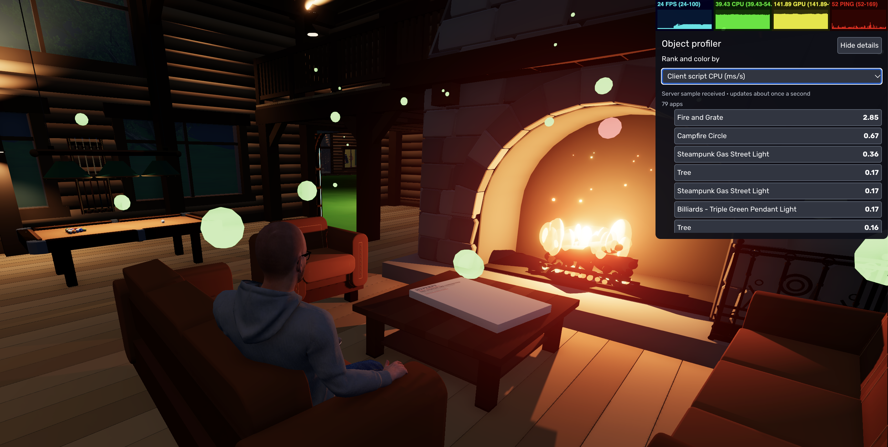

# Object performance profiler

Administrators can enable **View Stats**, then click **Show details** in the
Object profiler bar below the FPS, CPU, GPU and ping graphs. The graphs remain
visible above the expanded panel. **Hide details**, hiding Stats or the interface,
losing admin permission, or disconnecting stops profiling and clears readings.
Showing Stats again leaves profiling off until details are explicitly opened.
The control affects only the current browser and does not save an enabled state.

The inspector ranks individual app instances. Select a row or click an orb to
inspect its raw readings. The chosen metric controls both ranking and orb color:
green means low, red means highest in this scene; there is no mixed-unit total
score. Orbs sit above mounted mesh bounds (or the app origin when there are no
meshes). All orbs share one instanced mesh, without changing world mesh batching.
They refresh twice a second, including their positions; very fast moving objects
can move ahead of their marker until the next sample.

The screenshot shows the cabin ranked by client script CPU. Readings and orb
colors depend on the selected metric, scene, and reporting client.

## Readings and limits

| Reading | Meaning |
| --- | --- |
| Script CPU | Measured synchronous CPU milliseconds per second for app events (including update, fixedUpdate, animate, lateUpdate), world events and app timers. Nested instrumented callbacks use exclusive time. Async continuations, script initialization, fetch continuations, and native node callbacks are excluded. |
| Peak callback | Largest exclusive callback duration in the last half-second sample, in milliseconds. |
| Triangles, meshes, materials | Counts from mounted stage geometry, including script-created and detached world nodes owned by the app. Shared geometry counts for each instance. These are resource counts, not visible draw calls or GPU milliseconds. |
| Bodies, colliders | Mounted client PhysX actors and their shapes. |
| Active bodies, contact links | Snapshot of the last physics step and body contact links. A pair within one app contributes a link at each body; no per-body physics time is claimed. |
| Lights, shadow casters | Mounted light and shadow-casting light counts. These do not measure lighting GPU impact. |
| Network | Encoded MessagePack entity-event/add/modify/remove packets attributed to existing app IDs, sent and received by this client. Includes MessagePack headers, excludes WebSocket/TLS overhead, asset transfers, shared snapshots, blueprints, voice, player traffic and server traffic unseen by this client. An add arriving before its app exists is unattributed. |

CPU and network rates use a time-based exponentially weighted moving average with
a two-second time constant. Callback breakdown and message counts describe only
the last sample. Overlay and inspector work add diagnostic overhead. Turning the
profiler off skips timing, sampling, packet attribution and rendering; event
wrappers retain a cheap disabled check. Disabled network hooks skip packet
attribution entirely, and the idle server profiler does not poll viewers or read
clocks each frame. Explicit Agent API server profiling remains independent.

The continuous ranking does not measure per-object GPU time, memory, or server
physics. Geometry counts do not include Gaussian splat rendering or quantify
portal render passes. Server script timing and an on-demand GPU comparison are
available separately, as described below. Removing an object does not necessarily
recover a displayed amount of frame time.

## Estimate GPU rendering cost

Select an app, then click **Measure GPU cost**. Keep the camera and object still
and the browser tab visible. The comparison requires WebGL2 GPU timer support
and is unavailable during immersive XR.

The measurement runs four phases: the full scene, the scene without the selected
app's shadow-casting lights casting shadows, the scene without the app's rendering,
and the full scene again. Each phase lasts at least four seconds, discards its
first second for warm-up, and collects at least 20 GPU samples. App scripts and
physics remain active; rendering changes are temporary and local.

Results show the **Object rendering difference** and **Object shadow difference**
in milliseconds per frame, alongside uncertainty, scene GPU time with and without
the app, resolution, and sample counts. The rendering difference includes the
shadow difference; do not add them together. These are scene comparisons, not
exclusive timings of the object's draw calls. Differences within the uncertainty
are marked **inconclusive**.

Moving the camera or object, changing its blueprint or the rendering resolution,
hiding the tab, or starting XR cancels the measurement. An unstable GPU timer also
cancels it. You can use **Cancel GPU measurement** at any time. Results describe
the measured view and resolution; repeat the comparison after changing the scene
or viewpoint.

## Script switch API

`world.toggleProfiler()` toggles the local profiler; an optional boolean explicitly
enables or disables it. It returns the resulting enabled state. Invalid arguments,
non-admin enable attempts, and server calls return `false`. `world.isProfiling`
reports this client's enabled state. Permissions are checked in the engine.

## Verification

Run `node --test src/core/systems/ClientProfiler.test.mjs`, then `npm run build`.
Use a disposable world to compare a static box to a busy scripted multi-mesh app,
change ranking metrics, select an orb, toggle off/on, and confirm two clients have
independent state. The profiler is not registered in server or portal-preview
worlds.

Active admin clients also expose their measurements through the authenticated [Agent API](agent-api.md#client-profiling). Samples remain separated by reporting client and include freshness; they are not server timings.

The ranked inspector currently uses the desktop/touch interface; an immersive XR inspector is deferred.

Server script timing is available separately through the [Agent API](agent-api.md#server-profiling): enable it with `POST /profiling`, then read the `server` section of `GET /profiling`. It needs no browser and measures synchronous server app callbacks in ms/s, not engine physics or whole-process CPU. The on-screen metric selector includes Client script CPU and Server script CPU; the selected object shows separate peaks and callback breakdowns. Missing or stale server samples display a dash and gray orbs, not zero. Opening an admin profiler automatically enables server sampling while fresh client reports are arriving. Server samples arrive about once a second; reloading an older browser is required.
