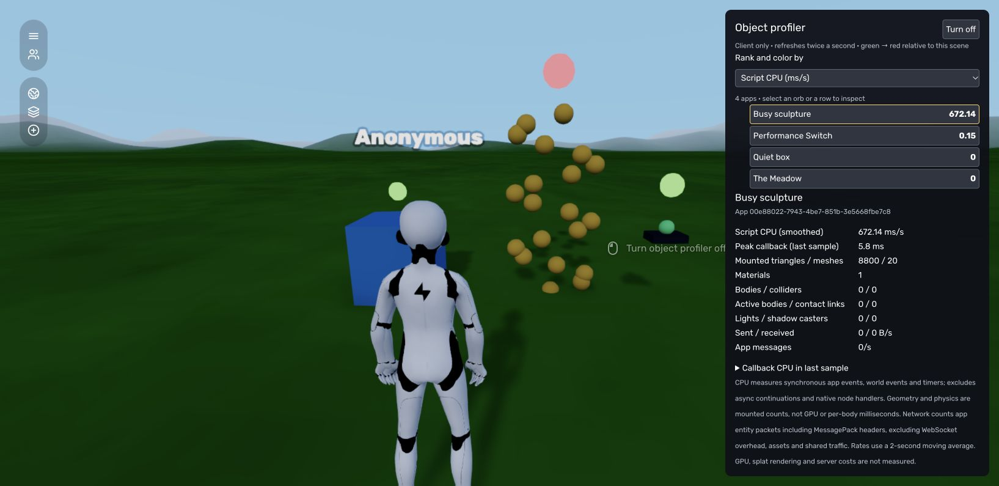

# Object performance profiler

Administrators can enable **Preferences → Object Profiler**, or place **Add App →
Default → Performance Switch** and click it (or aim at it and use its interaction action). The switch controls only the
current browser. It does not change other visitors' settings or save an enabled
state. Losing admin permission, disconnecting, or turning it off clears readings
and disposes the overlay. Existing global Stats remain available separately.

The inspector ranks individual app instances. Select a row or click an orb to
inspect its raw readings. The chosen metric controls both ranking and orb color:
green means low, red means highest in this scene; there is no mixed-unit total
score. Orbs sit above mounted mesh bounds (or the app origin when there are no
meshes). All orbs share one instanced mesh, without changing world mesh batching.
They refresh twice a second, including their positions; very fast moving objects
can move ahead of their marker until the next sample.

The screenshot uses a deliberately busy scripted fixture; readings are from that
fixture, not the live world.

## Readings and limits

| Reading | Meaning |
| --- | --- |
| Script CPU | Measured synchronous CPU milliseconds per second for app events (including update, fixedUpdate, animate, lateUpdate), world events and app timers. Nested instrumented callbacks use exclusive time. Async continuations, script initialization, fetch continuations, and native node callbacks are excluded. |
| Peak callback | Largest exclusive callback duration in the last half-second sample, in milliseconds. |
| Triangles, meshes, materials | Counts from mounted stage geometry, including script-created and detached world nodes owned by the app. Shared geometry counts for each instance. These are resource counts, not visible draw calls or GPU milliseconds. |
| Bodies, colliders | Mounted client PhysX actors and their shapes. |
| Active bodies, contact links | Snapshot of the last physics step and body contact links. A pair within one app contributes a link at each body; no per-body physics time is claimed. |
| Lights, shadow casters | Mounted light and shadow-casting light counts. These do not measure lighting GPU impact. |
| Network | Encoded MessagePack entity-event/add/modify/remove packets attributed to existing app IDs, sent and received by this client. Includes MessagePack headers, excludes WebSocket/TLS overhead, asset transfers, shared snapshots, blueprints, voice, player traffic and server traffic unseen by this client. An add arriving before its app exists is unattributed. |

CPU and network rates use a time-based exponentially weighted moving average with
a two-second time constant. Callback breakdown and message counts describe only
the last sample. Overlay and inspector work add diagnostic overhead. Turning the
profiler off skips timing, sampling, packet attribution and rendering; event
wrappers retain a cheap disabled check.

This first version does not measure GPU time, Gaussian splat rendering, portals'
render passes, memory, server scripts or server physics. It makes no claim that
removing an object will recover a displayed amount of frame time.

## Script switch API

`world.toggleProfiler()` toggles the local profiler; an optional boolean explicitly
enables or disables it. It returns the resulting enabled state. Invalid arguments,
non-admin enable attempts, and server calls return `false`. `world.isProfiling`
reports this client's enabled state. Permissions are checked in the engine.

The bundled switch's readable source is `scripts/profiler-switch.js`. Rebuild its
native `.hyp` container with `node scripts/build-profiler-switch.mjs` after edits.

## Verification

Run `node --test src/core/systems/ClientProfiler.test.mjs`, then `npm run build`.
Use a disposable world to compare a static box to a busy scripted multi-mesh app,
change ranking metrics, select an orb, toggle off/on, and confirm two clients have
independent state. The profiler is not registered in server or portal-preview
worlds.

Active admin clients also expose their measurements through the authenticated [Agent API](agent-api.md#client-profiling). Samples remain separated by reporting client and include freshness; they are not server timings.

The ranked inspector currently uses the desktop/touch interface; an immersive XR inspector is deferred.

Server script timing is available separately through the [Agent API](agent-api.md#server-profiling): enable it with `POST /profiling`, then read the `server` section of `GET /profiling`. It needs no browser and measures synchronous server app callbacks in ms/s, not engine physics or whole-process CPU. The on-screen metric selector includes Client script CPU and Server script CPU; the selected object shows separate peaks and callback breakdowns. Missing or stale server samples display a dash and gray orbs, not zero. Opening an admin profiler automatically enables server sampling while fresh client reports are arriving. Server samples arrive about once a second; reloading an older browser is required.
