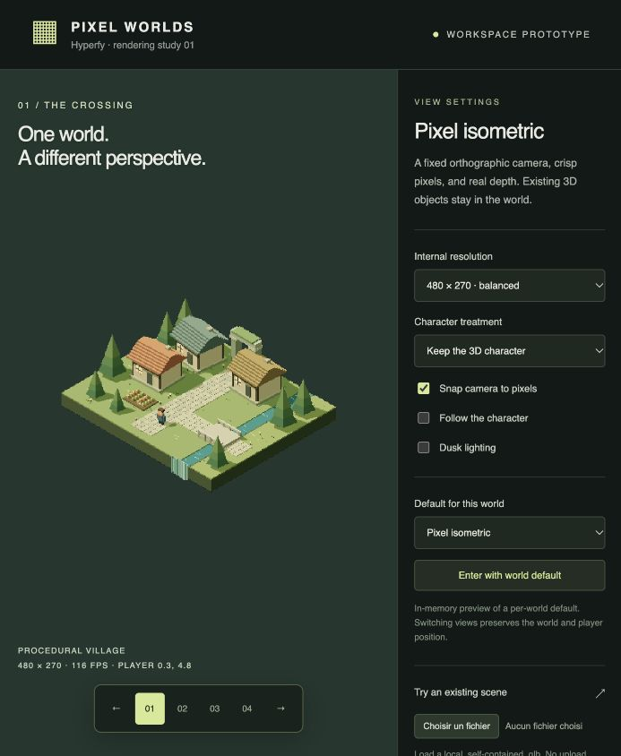

# Hyperfy rendering prototype

An isolated visual study for switching an existing Hyperfy world between normal
3D and pixel rendering. Its village now also runs in a native Hyperfy world,
`world-2d`, using the retro orthographic mode integrated in this workspace with
rendering up to 1024×768 pixels.

Follow [the world-2d setup guide](../../docs/rendering.md) to seed and launch the
native world. Use the sidebar's Graphics → Rendering arrows to switch views.
The following instructions describe the separate comparison preview.



## Run

From the workspace root:

```sh
npm run prototype:isometric
```

Open `http://127.0.0.1:4318`. `PORT=4319 npm run prototype:isometric` changes
the port. The server listens only on localhost.

This prototype uses the root project's installed dependencies. It can also run independently:

```sh
cd prototypes/isometric-renderer
npm install
npm run dev
```

`npm run prototype:isometric -- --build` bundles the prototype without starting
the server. Restart the server after changing JavaScript. HTML and CSS are read
on every request.

## Compare

All four URL presets share the same scene and player:

| Query | Rendering |
| --- | --- |
| `?variant=isometric` | Orthographic camera, 45 degree yaw, approximately 35.264 degree elevation, low resolution |
| `?variant=hd2d` | Low perspective view, atmospheric fog, bloom, low resolution |
| `?variant=retro` | Steeper, straight-on orthographic composition with flatter lighting |
| `?variant=standard` | Perspective reference at display resolution |

WASD moves relative to the camera. Q/E rotate in 45 degree increments. R resets
the player and camera framing. Left/right arrows cycle presets.

The inspector controls internal resolution, camera pixel snapping, following,
dusk, and a choice between the existing mesh character and an original pixel
sprite. “Enter with world default” demonstrates a default plus a local override.
That default lives only in this page's memory.

A self-contained `.glb` can replace the demonstration village. It is read locally
and normalized to the preview's scale; it is not uploaded. External GLB resource
URLs are rejected. Draco/KTX2 decoders, imported collision, animation playback,
scripts, and a network session are not included.

## What this answers

- A low-resolution view can reuse 3D scene geometry and depth.
- The scene and player need not be reconstructed when the view changes.
- Sprite characters are an optional art direction, not a prerequisite for
  switching an existing game to a pixel view.
- The different camera compositions make quite different demands on world
  layout and foreground occlusion.

Pixelation does not turn arbitrary 3D assets into authored pixel art. Dense
textures, tiny details, indoor ceilings, unreadable silhouettes, and hiding
the character behind foreground objects require assessment on real worlds.

The strict isometric and retro views demonstrate screen-space camera snapping.
Perspective mode intentionally disables that checkbox: constant world-units-per-
pixel snapping is not valid across perspective depth. Small browser panels use
fractional downscaling to fit the image; integer scaling needs a larger viewport.
Character motion itself is not snapped to the pixel grid.

## Implementation direction

See [NOTES.md](NOTES.md) for the integration status, repository findings,
remaining compatibility work, and outstanding art decisions. `village.js` is
shared by the preview and the native world seed.

## References

- [Three.js OrthographicCamera](https://threejs.org/docs/#OrthographicCamera)
- [Three.js RenderTarget](https://threejs.org/docs/#RenderTarget)
- [Three.js pixelated postprocessing example](https://threejs.org/examples/#webgl_postprocessing_pixel)
- [Octopath Traveler II developer interview](https://www.unrealengine.com/en-US/developer-interviews/octopath-traveler-ii-builds-a-bigger-bolder-world-in-its-stunning-hd-2d-style)

These are references for rendering primitives and art direction. The demo is a
small interpretation, not a reproduction of either referenced game's graphics.
